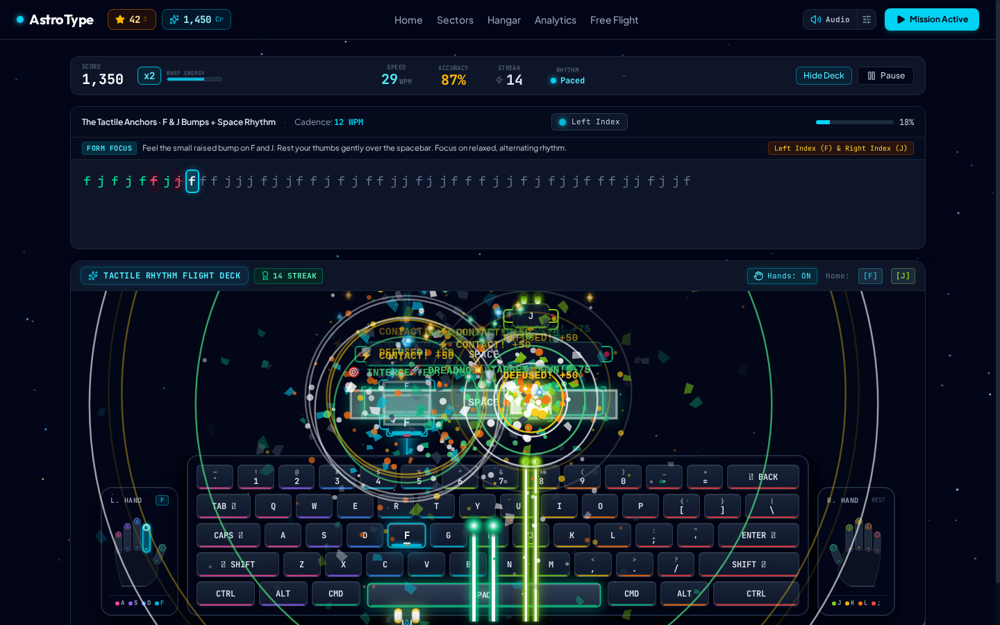
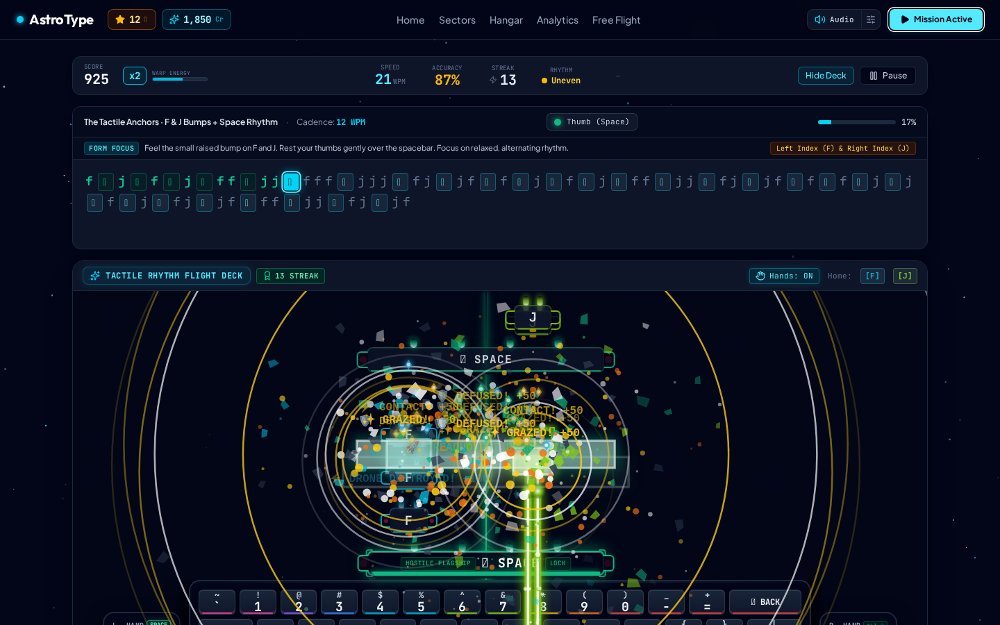
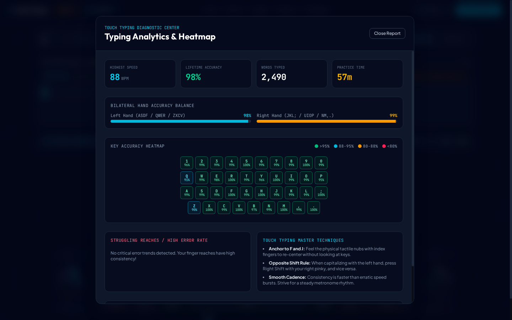
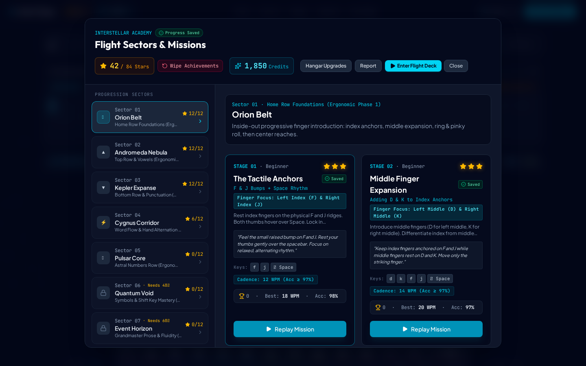
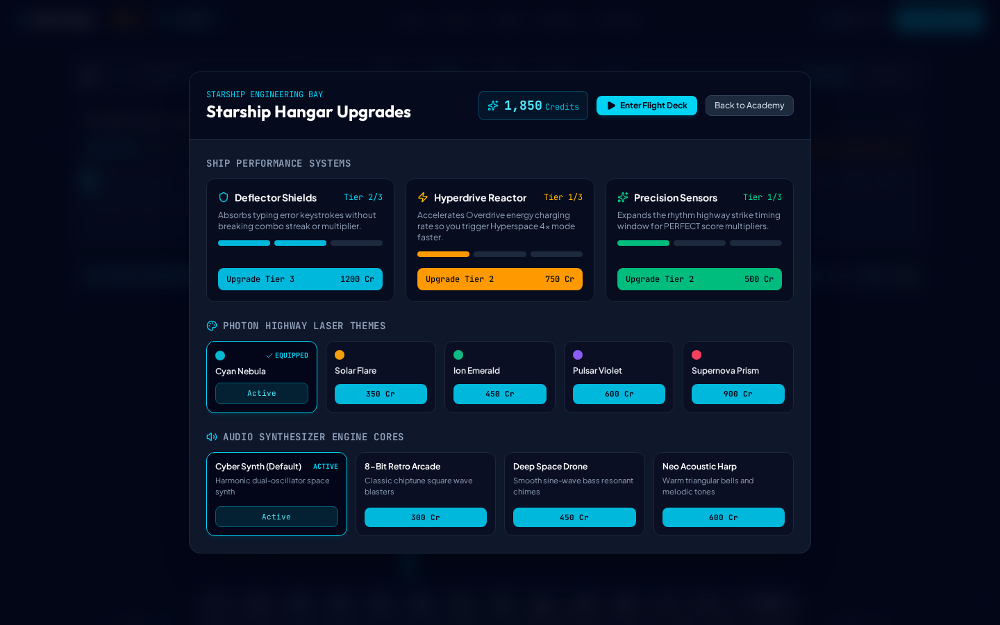

# 🚀 AstroType: Cosmic Touch Typing Academy

[](LICENSE)
[](https://react.dev/)
[](https://www.typescriptlang.org/)
[](https://tailwindcss.com/)
[](https://developer.mozilla.org/en-US/docs/Web/API/Web_Audio_API)

> **A space-futuristic touch-typing rhythm simulator that blends time-tested touch-typing pedagogy with arcade rhythm mechanics.** Master the entire keyboard matrix across 7 star-gated galaxy sectors, guide falling laser notes onto an ANSI 60% mechanical receptor deck, shoot down descending drone swarms with dynamic altitude blasters, and track real-time ergonomic telemetry.

---

<p align="center">
  
</p>

---

## 🌟 Table of Contents
1. [Overview & Philosophy](#-overview--philosophy)
2. [Real In-Game Visual Showcase](#-real-in-game-visual-showcase)
3. [Key Features](#-key-features)
4. [The 8-Finger + Thumb Color System](#-the-8-finger--thumb-color-system)
5. [7-Sector Pedagogical Curriculum](#-7-sector-pedagogical-curriculum)
6. [Rhythm Highway & Combat Mechanics](#-rhythm-highway--combat-mechanics)
7. [Tactile Deck & Hand Ergonomics](#-tactile-deck--hand-ergonomics)
8. [Synthesized Audio Engine](#-synthesized-audio-engine)
9. [Diagnostics, Analytics & Heatmap](#-diagnostics-analytics--heatmap)
10. [Starship Hangar Upgrades](#-starship-hangar-upgrades)
11. [Architecture & Technical Stack](#-architecture--technical-stack)
12. [Project Structure](#-project-structure)
13. [Getting Started & Development](#-getting-started--development)
14. [Controls & Shortcuts](#-controls--shortcuts)
15. [License](#-license)

---

## 🌌 Overview & Philosophy

Most typing tutors feel like sterile word processors; rhythm games often lack structured educational progression. **AstroType bridges both worlds**:

- **Real Muscle-Memory Pedagogy**: Grounded in classic touch-typing fundamentals—anchor keys `F` & `J`, strict finger-to-column isolation, and the opposite-hand shift pinky rule.
- **Physical Keycap Alignment**: Falling notes match the exact shape and unit width (`1u`, `1.5u`, `2.25u`, `6.25u`) of your physical keys and land directly on the keyboard receptor deck.
- **Dynamic Altitude Targeting**: When typing a character, your ship's plasma blaster calculates the exact live vertical altitude and horizontal coordinate of the targeted enemy drone, firing a frame-accurate bolt that detonates on impact.
- **Misfire Angle Guidance**: Striking the wrong key fires an angled tracer straight toward the keycap you pressed, immediately showing you which reach error occurred.
- **Diffused Single-Beam Laser Guidance**: A constant-width, vertically ramped laser beam guides your eyes to the center of each falling note, eliminating jarring visual shifts across keys of different sizes.
- **Ergonomic Bilateral Hand Guides**: Vector SVG hands flank the keyboard to illuminate target fingers in real-time, complete with smart spacebar thumb alternation recommendations.
- **Zero-Latency Web Audio Synthesis**: Completely procedural sound design—no heavy audio samples. Keystroke blasters and rhythm beats are synthesized live with Web Audio oscillators.

---

## 📸 Real In-Game Visual Showcase

All screenshots below are captured directly from the live running application:

### 1. Active Combat Highway & Upward Laser Salvo
Descending enemy drones drop down continuous laser conduits toward your mechanical flight deck. Correct keystrokes fire plasma blaster cannons straight up from the ship directly into the targeted drone, detonating hazards with circular shockwaves, shattered voxel debris, floating arcade energy crystals, and combat score ratings (`CONTACT! +50`, `DEFUSED! +50`, `TARGET DOWN! +75`).

<p align="center">
  
</p>

### 2. Misfire Angle Guidance System
Striking an incorrect key fires an angled plasma tracer line directly from your starship underneath the keyboard to the exact keycap you mistakenly pressed. A visual warning reticle and impact flash immediately illustrate the physical reach error.

<p align="center">
  
</p>

### 3. Touch Typing Diagnostic Center & Key Accuracy Heatmap
Access the real-time Diagnostic Center from the flight deck to view per-key lifetime hit accuracy percentages (>95% emerald, 88–95% cyan, 80–88% amber, <80% rose), bilateral left-hand vs. right-hand accuracy balance, words typed, and touch-typing master technique reminders.

<p align="center">
  
</p>

### 4. 7-Sector Galaxy Mission Progression Map
Progress through 28 curated pedagogical stages across 7 star-gated galaxy sectors (Orion Belt, Andromeda Nebula, Kepler Expanse, Cygnus Corridor, Pulsar Core, Quantum Void, and Event Horizon). Each stage features target cadences, finger focus badges, and 3-star ratings.

<p align="center">
  
</p>

### 5. Starship Hangar Upgrades & Audio Cores
Spend cosmic credits earned from high-precision flights to install Deflector Shields (absorbing mistake keystrokes), Hyperdrive Reactors (charging Overdrive warp mode faster), Precision Sensors (expanding timing windows), and procedural Web Audio synthesizer cores (Cyber Synth, 8-Bit Retro Arcade, Deep Space Drone, Neo Acoustic Harp).

<p align="center">
  
</p>

---

## 🎮 Key Features

| Feature | Description |
| :--- | :--- |
| **Subtle Space Indicators** | Elegant, non-boxed `␣` glyphs in the target stream that cleanly distinguish space characters without visual clutter, elevating to focused cyan glow when actively targeted. |
| **Highway Note Speed** | Adjustable visual scroll rate (`SLOW` 0.9x, `NORMAL` 1.5x, `FAST` 2.2x, `HYPER` 3.4x) controlling how quickly approaching notes descend down the flight lanes for tailored reflex challenge without altering target WPM. |
| **Vertically Taller Highway** | Expanded vertical corridor with elevated orbital ceiling, providing extended flight time and a clearer incoming roadmap. |
| **Enlarged Vector Key Legends** | Scaled-up, bold typeface on both physical keycaps and falling enemy drone hulls for effortless high-speed peripheral legibility. |
| **Tactile Flight Deck** | 1:1 ANSI layout with tactile homing nubs (`F` & `J`), reactive duration-of-press glow, and dynamic keycap labels. |
| **Live Altitude Blaster Tracking** | Plasma bolts calculate the exact frame coordinate of falling drones, producing realistic detonations at any height. |
| **Misfire Error Tracers** | Striking an incorrect key fires an angled laser line directly to the pressed keycap, reinforcing visual error correction. |
| **Laser Guidance Marker** | Single center line with vertical ramp up and down glow; constant width regardless of whether targeting letter keys or the spacebar. |
| **Dual SVG Hand Visualizers** | Ergonomic left and right palms indicating finger positions, tactile bumps, and intelligent spacebar hand recommendations. |
| **Blind Touch-Typing Mode** | Toggle deck legends off to replace key characters with tactile muscle-memory dots for true sightless mastery. |
| **Overdrive Warp Mode** | Maintain combos to fill your warp reactor. Activates a `x4` score overdrive with hyperspace starfield trails. |
| **Direct Flight Deck Launchers** | Dedicated, 100% reliable "Enter Flight Deck" and "Resume Flight" buttons across Hangar, Analytics, and Sectors ensure instant cockpit entry from any screen. |
| **Context-Aware Navigation** | Modals dynamically route back to their exact origin (Academy Home, Sectors, Debriefing, or Pause Menu) without broken redirects or dead ends. |
| **Top Flight Deck Controls** | Persistent header action button dynamically toggles `Pause Flight` during active missions and `Resume Flight` / `Start Mission` when in menus. |
| **Interactive Heatmap** | Color-coded keyboard diagnostic matrix revealing hit rates, bilateral hand balance, and struggling finger reaches. |
| **Hangar Progression** | Earn cosmic credits to purchase Deflector Shields, Hyperdrive Reactors, Precision Sensors, and Synth Cores. |
| **Offline Data Portability** | Full profile progress, stars, and key statistics are stored locally with JSON export and import capabilities. |

---

## 🎨 The 8-Finger + Thumb Color System

Every single finger (except thumbs, which share emerald green) has a unique, high-contrast neon hue that remains consistent across:
1. **The physical keyboard deck keycaps and bottom accent bars**
2. **The falling rhythm notes and their glow trails**
3. **The central diffused laser guidance beam**
4. **The anatomical left and right hand visualizers**
5. **The live target guidance pill in the prompt stream**
6. **The analytics diagnostic reach report**

| Hand | Finger | Color Code | Hex Code | Assigned Keys (ANSI) |
| :--- | :--- | :---: | :---: | :--- |
| **Left Hand** | Pinky | 🌸 Vibrant Pink | `#ec4899` | `` ` 1 Q A Z Tab Caps Shift Left Ctrl `` |
| **Left Hand** | Ring | 🔮 Deep Violet | `#8b5cf6` | `2 W S X Alt Left` |
| **Left Hand** | Middle | ⚡ Electric Blue | `#3b82f6` | `3 E D C` |
| **Left Hand** | Index | 💎 Bright Cyan | `#06b6d4` | `4 5 R T F G V B` *(Home Anchor: [F])* |
| **Thumbs** | Thumbs | 🌲 Emerald Green | `#10b981` | `Spacebar (6.25u)` + `Cmd / Meta` |
| **Right Hand** | Index | 🍋 Neon Lime | `#84cc16` | `6 7 Y U H J N M` *(Home Anchor: [J])* |
| **Right Hand** | Middle | ☀️ Golden Yellow | `#eab308` | `8 I K , <` |
| **Right Hand** | Ring | 🍊 Sunset Orange | `#f97316` | `9 O L . > Alt Right` |
| **Right Hand** | Pinky | 🔴 Crimson Red | `#ef4444` | `0 - = P [ ] \ ; ' / Enter Backspace Shift Right` |

---

## 🗺️ 7-Sector Pedagogical Curriculum

Progress through **28 stages across 7 galaxy sectors**, earning up to **84 Stars** (3 stars per stage based on WPM, Accuracy, and Combo Streaks):

```
🌌 GALAXY SECTORS MAP
├── Sector 1: Orion Belt · Home Row Foundations (Ergonomic Phase 1)
├── Sector 2: Andromeda Nebula · Top Row & Vowels (Ergonomic Phase 2)
├── Sector 3: Kepler Expanse · Bottom Row & Punctuation (Ergonomic Phase 3)
├── Sector 4: Cygnus Corridor · Word Flow & Hand Alternation (Ergonomic Phase 4)
├── Sector 5: Pulsar Core · Astral Numbers Row (Ergonomic Phase 5)
├── Sector 6: Quantum Void · Symbols & Shift Key Mastery (Ergonomic Phase 6)
└── Sector 7: Event Horizon · Grandmaster Prose & Fluidity (Ergonomic Phase 7)
```

### Pedagogical Touch-Typing Rules Enforced:
1. **The Anchor Law**: Never lift index fingers without maintaining tactile awareness of the `F` and `J` homing bumps.
2. **Opposite-Shift Rule**: When typing a capital letter with the left hand, press `Right Shift` with the right pinky (and vice versa).
3. **Smart Thumb Alternation**: Recommends pressing Space with the thumb opposite to the hand that typed the preceding letter, preserving hand balance and momentum.
4. **Cadence Consistency**: Real-time standard deviation metric encourages steady metronomic flow over erratic speed bursts.

---

## ⚡ Rhythm Highway & Combat Mechanics

AstroType features a falling-highway mechanic designed specifically for typing accuracy and instant micro-gratification:

- **Orbital Interceptor Position**: Your starship sits directly underneath the keyboard flight deck, aligning intuitively with the upward flight path of the lasers into the descending hazards above.
- **Dynamic Altitude Blaster Bolts**: Plasma projectiles calculate the exact altitude of targeted drones at the moment of key press. High drones are struck near the top of the screen; low drones detonate just above the keycaps.
- **Misfire Angle Guidance**: Pressing the wrong key fires an angled tracer straight toward the keycap you pressed, immediately illustrating which key was erroneously struck.
- **Shattering Debris & Voxel Physics**: Falling notes detonate into angular spinning rock/metal fragments that burst outward with physics-driven velocity and gravity.
- **Flying Arcade Energy Crystals**: Detonations dislodge glittering diamond energy shards that pop up and drift toward your score counter for classic arcade collection gratification.
- **Dynamic Combat Exclamations**: Impact ratings pop up at the blast zone with high-energy military ratings (`VAPORIZED! +100`, `CRITICAL HIT! +100`, `SHATTERED! +75`, `WARP STRIKE! +400`).
- **Photon Torpedo Salvo (Spacebar Finishers)**: Hitting the spacebar launches a heavy ordinance torpedo with a double-ring shockwave and deep sub-bass resonance.
- **Active Lock-On Reticle**: The descending target note displays subtle pulsed sci-fi corner targeting brackets (`[ ]`), focusing your attention on the incoming cosmic hazard without obstructing text.

---

## ⌨️ Tactile Deck & Hand Ergonomics

- **1:1 Keycap Proportions**: Each key has physical ANSI unit dimensions (`1u = 46px`, `Tab = 1.5u`, `Caps = 1.75u`, `Backspace = 2u`, `Enter = 2.25u`, `Space = 6.25u`).
- **Tactile Homing Nubs**: Visual raised bumps on `[F]` and `[J]` replicate standard Cherry MX and OEM homing keys.
- **Center Diffused Laser Beam**: A single vertical beam passes through the horizontal center of the target key. It has a constant width across all keys and features a vertical glow ramp-up from top and ramp-down to bottom.
- **Smart Thumb Guidance**: The Spacebar displays dynamic recommendation badges (`SPACE ◀ L. THUMB [REC] ▶`) based on the preceding keystroke to ensure even hand alternation.

---

## 🔊 Synthesized Audio Engine

Built entirely on the browser's native **Web Audio API** with zero external audio assets:

### 4 Audio Synth Cores:
1. **Cyber Synth (Default)**: Dual-oscillator harmonic space chime with shimmering overtone decay.
2. **Retro 8-Bit Arcade**: Authentic square-wave chiptune blasters with pitch-bend attack.
3. **Deep Space Drone**: Resonant sub-bass and warm sine-wave chimes.
4. **Neo Acoustic Harp**: Warm triangular bell harmonics and organic kalimba tones.

### Real-Time Procedural Rhythm Beat Tracks:
- **Neon Synthwave**: 106 BPM retro-futuristic bassline and snare pocket.
- **Cyber Pulse**: 122 BPM high-tempo energetic electro groove.
- **Cosmic Lo-Fi**: 84 BPM relaxed chillout beat for focused training.

---

## 📊 Diagnostics, Analytics & Heatmap

Access the **Touch Typing Diagnostic Center** anytime from the flight deck:

- **Interactive Key Accuracy Heatmap**: Every keycap is dynamically styled based on lifetime accuracy:
  - 🟢 **>95%**: Flawless mastery
  - 🔵 **88%–95%**: Proficient touch reach
  - 🟡 **80%–88%**: Developing reach
  - 🔴 **<80%**: High error rate
- **Bilateral Hand Balance**: Real-time split measuring left-hand vs. right-hand accuracy and speed.
- **Struggling Reaches Breakdown**: Identifies error-prone fingers (e.g. pinky reaches to `Q`, `Z`, `-`) and provides targeted ergonomic tips.
- **Data Backup & Restore**: One-click JSON backup export and import to preserve progress across devices.
- **Curriculum Reset Utility**: Safely wipe achievements to start fresh on newly unlocked curriculum versions while keeping hangar unlocks.

---

## 🛠️ Starship Hangar Upgrades

Earn credits on every completed mission to unlock starship enhancements:

- 🛡️ **Deflector Shields (Levels 1–3)**: Absorbs 1–3 typing mistakes per mission without breaking your combo streak.
- ⚡ **Hyperdrive Reactor (Levels 1–3)**: Accelerates Overdrive warp energy charging by +20% to +60%.
- 🎯 **Precision Sensors (Levels 1–3)**: Widens the hit timing window for PERFECT ratings by +15% to +45%.
- 🌈 **Laser Trail Themes**: Equip Cyan Nebula, Solar Flare Amber, Ion Emerald, Pulsar Violet, or Supernova Prism.

---

## 🏛️ Architecture & Technical Stack

AstroType is built using modern, type-safe, production-grade frontend architecture:

```
┌────────────────────────────────────────────────────────────────────────┐
│                              App.tsx                                   │
│            (Top-Level Orchestrator & View Switcher)                    │
└──────┬──────────────────┬──────────────────┬────────────────────┬──────┘
       │                  │                  │                    │
┌──────▼────────┐  ┌──────▼────────┐  ┌──────▼───────────┐  ┌─────▼───────┐
│ HeaderNav.tsx │  │    HUD.tsx    │  │ TextPromptStream │  │ GlobalCosmic│
│ (Volume/Menu) │  │  (Telemetry)  │  │ (Live Finger UI) │  │ Background  │
└───────────────┘  └───────────────┘  └──────────────────┘  └─────────────┘
       │
┌──────▼─────────────────────────────────────────────────────────────────┐
│                      IntegratedLanesKeyboard.tsx                        │
│  - Falling Drones Canvas / SVG Highway (Active altitude coordinates)   │
│  - Laser Guidance Conduits & Dynamic Plasma Blaster Cannons            │
│  - Physical ANSI 60% Mechanical Keycap Deck with Homing Nubs           │
│  - Flanking Bilateral SVG Hand Visualizers                             │
│  - Misfire Angle Guidance System                                       │
│  - Particle Physics (Shattered Debris & Crystals)                      │
└──────────────────────────────────┬─────────────────────────────────────┘
                                   │
┌──────────────────────────────────▼─────────────────────────────────────┐
│                          Core State & Engines                          │
├──────────────────────────┬─────────────────────────┬───────────────────┤
│    useGameStore.ts       │      gameMachine.ts     │   soundEngine.ts  │
│   (Zustand Reactive)     │   (XState Finite State) │(Web Audio Synth)  │
├──────────────────────────┴─────────────────────────┴───────────────────┤
│            schemas.ts (Zod Validation) & curriculum.ts (ANSI)          │
└────────────────────────────────────────────────────────────────────────┘
```

- **Frontend Framework**: React 19 SPA running on Vite 8.
- **State Management**: Zustand store (`useGameStore.ts`) providing instantaneous reactive state across modals, telemetry calculations, and gameplay loops.
- **State Machine**: XState v5 (`gameMachine.ts`) orchestrating predictable game flow transitions (`IDLE` ➔ `COUNTDOWN` ➔ `PLAYING` ➔ `PAUSED` ➔ `LEVEL_COMPLETE` / `FAILED`).
- **Validation**: Zod schema validation (`schemas.ts`) enforcing runtime validation on profile state, JSON backup files, and curriculum structures.
- **Audio Core**: Native Web Audio API (`soundEngine.ts`) with zero external mp3/wav assets; live synthesis via multi-voice oscillators and biquad filter sweeps.
- **Styling**: Tailwind CSS v4 using modern `@import "tailwindcss"` standards, custom font stacks (`Outfit`, `JetBrains Mono`, `Plus Jakarta Sans`), and zero inline CSS.

---

## 📁 Project Structure

```
astrotype/
├── public/
│   └── screenshots/
│       ├── real_gameplay.png         # Active combat flight, laser salvo & telemetry
│       ├── real_misfire_guidance.png # Misfire angled tracer line to pressed keycap
│       ├── real_analytics_heatmap.png# Diagnostic center, heatmap & bilateral balance
│       ├── real_sector_map.png       # 7-Sector galaxy missions & star progression
│       └── real_hangar.png           # Starship hangar upgrades shop & audio cores
├── src/
│   ├── audio/
│   │   └── soundEngine.ts            # Web Audio API procedural synthesis & beats
│   ├── components/
│   │   ├── AnalyticsModal.tsx        # Heatmap & bilateral diagnostic center
│   │   ├── CustomPracticeModal.tsx   # Free-flight custom text practice runner
│   │   ├── GlobalCosmicBackground.tsx # Starfield & hyperspace warp particle engine
│   │   ├── HangarUpgradesModal.tsx   # Upgrades shop for shields, reactor, and cores
│   │   ├── HeaderNav.tsx             # Navigation, audio mixer menu, and telemetry
│   │   ├── HUD.tsx                   # Flight telemetry: WPM, Accuracy, Streak, Cadence
│   │   ├── IntegratedLanesKeyboard.tsx # Falling highway, keycap deck, and blasters
│   │   ├── LevelCompleteModal.tsx    # Victory debriefing, star calculation & rating
│   │   ├── SmallHandVisualizer.tsx   # Ergonomic bilateral SVG hand guides
│   │   ├── StageSelectModal.tsx      # 7-Sector galaxy mission selector
│   │   └── TextPromptStream.tsx       # Prompt stream with live finger guidance pill
│   ├── data/
│   │   └── curriculum.ts             # 28 stages, 7 sectors, and ANSI finger maps
│   ├── store/
│   │   ├── gameMachine.ts            # Finite state machine logic
│   │   ├── schemas.ts                # Zod validation schemas for player profiles
│   │   └── useGameStore.ts           # Zustand persistent reactive state store
│   ├── types/
│   │   └── game.ts                   # TypeScript interfaces and domain definitions
│   ├── utils/
│   │   └── storage.ts                # LocalStorage persistence, upgrades, star math
│   ├── App.tsx                       # Root application controller and modal orchestrator
│   ├── index.css                     # Tailwind CSS v4 styling & typography
│   └── main.tsx                      # React 19 bootstrap entry point
├── index.html                        # HTML5 entry with metadata & font preconnects
├── LICENSE                           # MIT License
├── metadata.json                     # AI Studio project configuration
├── package.json                      # Project dependencies and npm scripts
├── tsconfig.json                     # TypeScript configuration
└── vite.config.ts                    # Vite configuration with React & Tailwind plugins
```

---

## 🚀 Getting Started & Development

### Prerequisites
- [Node.js](https://nodejs.org/) 26 (see `.node-version`)
- [pnpm](https://pnpm.io/) 12 (pinned in `package.json` as `packageManager`)

### Installation
```bash
# Clone the repository
git clone https://github.com/your-username/astrotype.git

# Navigate into the project directory
cd astrotype

# Install dependencies
pnpm install
```

### Running Locally
```bash
# Start the Vite development server (port 3000)
pnpm dev
```
Open [http://localhost:3000](http://localhost:3000) in your browser.

### Building for Production
```bash
# Typecheck and build optimized bundle
pnpm build

# Preview the production build locally
pnpm preview
```

### Type Checking & Linting
```bash
pnpm lint
```

---

## ⌨️ Controls & Shortcuts

| Action | Shortcut / Control |
| :--- | :--- |
| **Type Falling Keys** | Physical keyboard keys |
| **Virtual Keystroke** | Click or tap any key on the visual keyboard |
| **Pause Mission** | `Esc` key or click the **Pause** button in the HUD |
| **Resume Flight** | Click **Resume Flight** or press `Enter` / `Space` in the pause modal |
| **Toggle Deck View** | Click **Hide Deck / Show Deck** in the top HUD |
| **Toggle Hands Guide** | Click **Hands: ON/OFF** in the keyboard deck header |
| **Audio Controls** | Click the Volume icon in the navigation bar to mix music and sound effects |
| **Open Hangar Upgrades** | Click **Hangar** in navigation or press `[H]` |
| **Open Analytics Heatmap** | Click **Diagnostics** in navigation or press `[D]` |
| **Custom Text Practice** | Click **Custom Drill** in navigation or press `[P]` |

---

## 📄 License

This project is licensed under the **MIT License** — see the [LICENSE](LICENSE) file for complete details.

---

<p align="center">
  <b>AstroType</b> · Built for touch-typists, rhythm game enthusiasts, and cosmic explorers.
</p>
